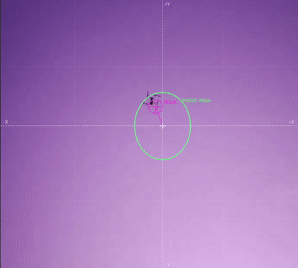
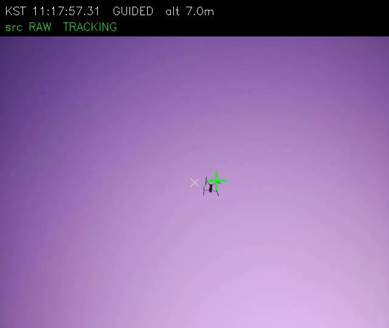
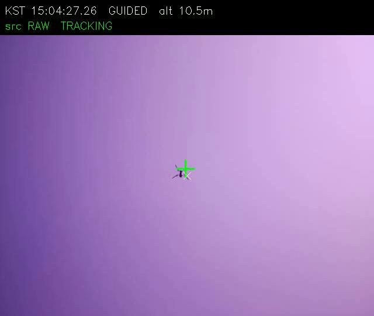
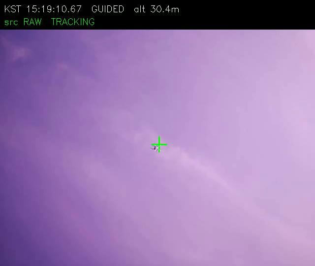
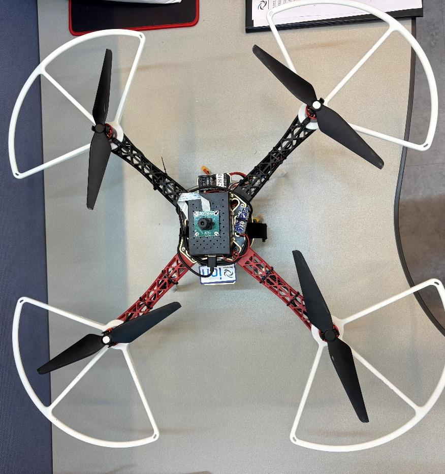

# 01 카메라 기반 드론 표적 추적 (Image-Based Visual Servoing)

> ROS 2 Humble · MAVROS · ArduPilot · Raspberry Pi 5 온보드 · Gazebo SITL · Python
> 기간 2026.05 ~ · 담당: 제어·유도 알고리즘 설계와 구현, 검증 환경 구축, 실기 배포
> 회사 업무 코드라 **코드는 공개하지 않고** 설계와 결과만 정리했습니다.

### 실기 추적 비행 (2026-10-15, 이동 표적 미션 비행)

▶ [지상 촬영 + 기체 카메라 나란히 보기 (50 s)](media/flight_side_by_side.mp4)

왼쪽은 지상에서 폰으로 찍은 영상이고(위 = 표적 Mavic 3, 아래 = 추적기 F450), 오른쪽은 같은 시각 기체 카메라에 찍힌 화면입니다(rosbag 기록). 두 영상은 폰 화면 속 두 드론의 좌우 간격과 카메라 속 표적의 좌우 위치가 가장 잘 겹치는 시점(상관계수 0.93)으로 맞췄습니다.



## 시스템 구조

```
단안 카메라 ─▶ 객체 탐지 ─▶ 칼만 필터 ─▶ 거리 적응 PID ─▶ 우선권 중재 ─▶ MAVROS ─▶ ArduPilot 자세 루프
640×480 30fps   (인지 담당)   게이트·코스팅   + 이미지 야코비안-D   (조종사 우선)
        ▲                                                                              │
        └──────────────── 기체 자세 변화가 다음 프레임의 픽셀 오차로 되돌아오는 폐루프 ─────┘
```

- 탐지 모델은 인지 담당 동료가 만들었고, 저는 **탐지 출력의 주기(15.6 Hz)·좌표 지터·실비행 인지율을 측정해 제어기 입력 조건으로 정리**한 뒤 그 뒤 단계 전부를 개발했습니다.
- 운용 순서: LOITER 호버 → 1.2 s 연속 인지 → 자동 GUIDED 인수 → 추적 → 스틱 개입 시 조종사에게 반환

## 설계

| 항목 | 값 | 근거 |
|---|---|---|
| 고유진동수 ωn | 0.70 rad/s | 폐루프 주파수응답 −90° 점 실측 0.74 rad/s |
| 감쇠비 ζ | 0.70 | 오버슈트 5 % 이내 |
| 초점거리 f | 795.18 px | 체스보드 캘리브레이션, 왜곡모델 잔차 < 0.01 px |
| 제어 주기 | 20 Hz | 온보드 IMU 20 Hz가 상한 |
| FC 자세 지연 τ | ≈ 0.28 s (실측) | 지연 때문에 PI로는 발산 → PID 채택 |

- **거리 적응 게인**: 게인을 거리에 비례시켜 픽셀↔미터 환산을 약분 (고정 게인이면 30 m에서 실효 ωn이 0.4배로 떨어짐)
- **칼만 필터**: 등속도 모델 + 이상치 게이트, 5회 연속 기각 시 재초기화, 500 ms 공백이면 제어권 해제
- **적분 분리(anti-windup)**: 인지 상태(RAW / HOLD / LOST)에 따라 적분을 멈춤

### D 신호원 선정 (시뮬레이션 비교)

| # | D 신호원 | 관측 | 판정 |
|---|---|---|---|
| ① | 픽셀 미분 | 1.2~1.6 Hz 리밋사이클 | 폐기 |
| ② | 기체 속도 (EKF) | 등속 추격 지연 5.20 m | 부족 |
| ③ | 표적속도 피드포워드 | 지연이 D로 재유입, 오차 +34 % | 폐기 |
| ④ | 워시아웃-D | 정지 오버슈트 3.55 m | 폐기 |
| ⑤ | **상대속도-D + 이미지 야코비안** | **15 m 추격 오차 11.09 → 0.08 m** | **채택** |

## 실기 비행 결과 (F450, 표적 Mavic 3)

| 항목 | 정지 표적 | 이동 표적 (미션 비행 2회) |
|---|---|---|
| 오차 중앙값 / p90 | 0.66 / 1.54 m | 1.69 / 5.45 m · 2.74 / 8.43 m |
| 화면 중심 60 px 이내 유지율 | 75 % | 36 % · 40 % |

- 자동 인수 → 온보드 폐루프 추적 → 조종사 반환 전 과정 성공
- GUIDED 중 고도 ±0.6 m 유지, **30 m 거리·화면 15~20 px 크기 표적도 97 % 추적 유지**

| 7 m (정지 표적) | 10 m (이동 표적) | 30 m (이동 표적) |
|---|---|---|
|  |  |  |



## 문제 해결: "게인 문제처럼 보였지만 명령이 도달하지 않았다"

추적 오차가 줄지 않아 처음에는 게인 문제처럼 보였습니다. 비행 로그와 rosbag을 대조하니 제어기가 20 Hz로 보낸 **자세 명령 4,167건이 비행제어기에 한 건도 도달하지 않았습니다.** 원인은 MAVROS의 추력 스케일 파라미터 누락으로 메시지가 통째로 버려진 것이었고, 수정 후 비행에서 명령↔응답 상관계수 0.95 이상으로 폐루프 성립을 확인했습니다.

## 남은 과제

- 강풍 시 칼만-D 떨림: 기체 회전이 표적 속도로 오인됨 → 칼만 입력에서 회전분(f·Δθ) 제거 예정
- 지상 구조물 오검출로 인한 오인수 2회 → 인수 조건 강화 필요
- 표적과의 거리 수렴은 아직 실기 미검증
