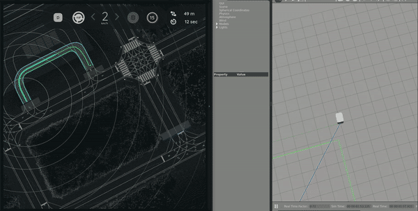
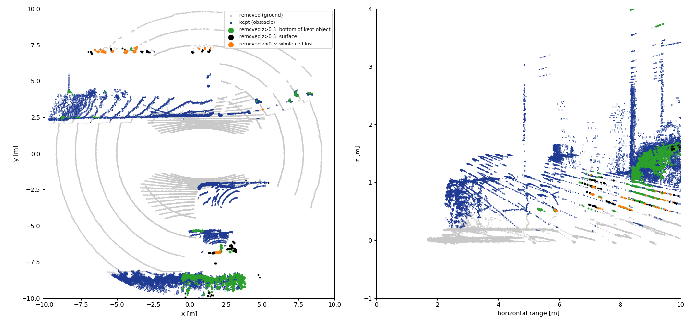
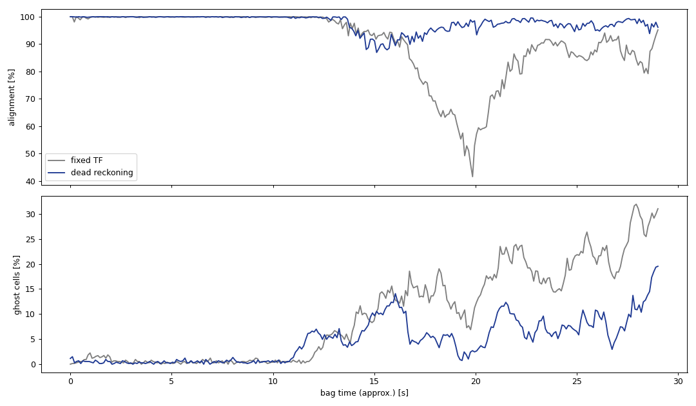

# 02 Autoware 3D 라이다 인지 · UGV 연동

> Ubuntu 22.04 · ROS 2 Humble · Autoware · Docker · Gazebo · Python
> 기간 2026.09 ~ 10 · 사내 선행연구 (UGV: AgileX Ranger Mini, 단일 3D 라이다)

**목표**: UGV에 3D 라이다를 달았을 때 장애물을 실시간으로 파악해 정지·회피에 쓸 수 있는지 확인하고, 실차와 같은 구조(차량·센서 구성 → 지도 → 시뮬레이션 주행)를 만든다.



## 1. 라이다 인지 파이프라인과 검증

```
3D 라이다 ─▶ 전처리(crop·왜곡보정) ─▶ 지면 제거 ─▶ 장애물 점군 ─┬▶ 유클리드 클러스터링 (물체 후보)
PointCloud2                                                    └▶ 점유격자 (정지·회피 판단용)
```

- 지도·위치추정·계획 없이 **인지만 따로 띄우는 launch**를 작성하고 ([`launch/perception_only.launch.xml`](launch/perception_only.launch.xml)), 위치추정 대신 차량 속도 + IMU 요레이트로 TF를 만드는 추측항법 노드를 붙였습니다 ([`tools/dead_reckoning.py`](tools/dead_reckoning.py)).
- 판정 기준은 **데이터를 보기 전에** 정하고, 판정은 스크립트로 했습니다.

| 판정 | 도구 | 결과 |
|---|---|---|
| 실시간성 (주기·지연) | [`judge_realtime.py`](tools/judge_realtime.py) | 인지 전용 1배속: **장애물 점군 10 Hz, 지연 +52 ms → 통과** / 전체 스택(182 노드): 6.6 Hz → 미달, 원인 분리 |
| 지면 제거 | [`judge_ground.py`](tools/judge_ground.py) | 물체 칸 2,711개 중 통째 누락 2.0 % · **추정 지면 위 0.2 m 미만 물체는 원리상 안 잡힘**을 수치로 확인 |
| 점유격자 정렬 | [`judge_ogm.py`](tools/judge_ogm.py) | 고정 TF vs 추측항법 TF 비교 → 추측항법에서 회전하는 "유령 벽" 제거 |

| 지면 제거 전후 (10 m 반경) | 점유격자 정렬 비교 |
|---|---|
|  |  |

## 2. 차량·센서 구성

- Ranger Mini용 **차량 패키지**(크기·조향 한계·속도 제한)와 **센서 키트**(단일 라이다, 장착 위치 TF)를 Autoware 샘플을 바탕으로 작성
- 차량 인터페이스 3단계(Autoware 명령 ↔ 차량 속도·조향) 변환 노드와 가짜 차량으로 계획 시뮬레이션 확인
- 실제 장착 센서(RoboSense Airy 라이다 · RealSense D435i)에 맞춰 바꿔야 할 항목을 정리해 인계

## 3. 라이다 점군으로 지도 만들기

- 팀에서 수집한 라이다 점군 지도 위에 **Lanelet2 벡터 지도**(차선·주차장)를 그림
- [`map_tools/topdown_ground.py`](map_tools/topdown_ground.py): 점군을 위에서 본 그림으로 바꿔 주행 가능 영역·구조물·이동 경로 표시 (라이다 높이로 검산)
- [`map_tools/check_osm.py`](map_tools/check_osm.py): 그린 지도가 Autoware 규칙(좌표계, 차선 연결·폭, 주차 칸, 정지점 위치)을 지키는지 자동 검사

## 4. Gazebo 연동 주행

- Gazebo에 Ranger 모델을 구성하고 Autoware와 연동해 차선 주행
- 판정 6항목(경로·자율 전환 / 도착 오차 / 비상정지 0회 / 주기 / 속도 참값 대조 / 최고속 제한) **전부 통과**: 도착 오차 0.18 m · 방향 0.45° · 최고속 1.40 m/s
