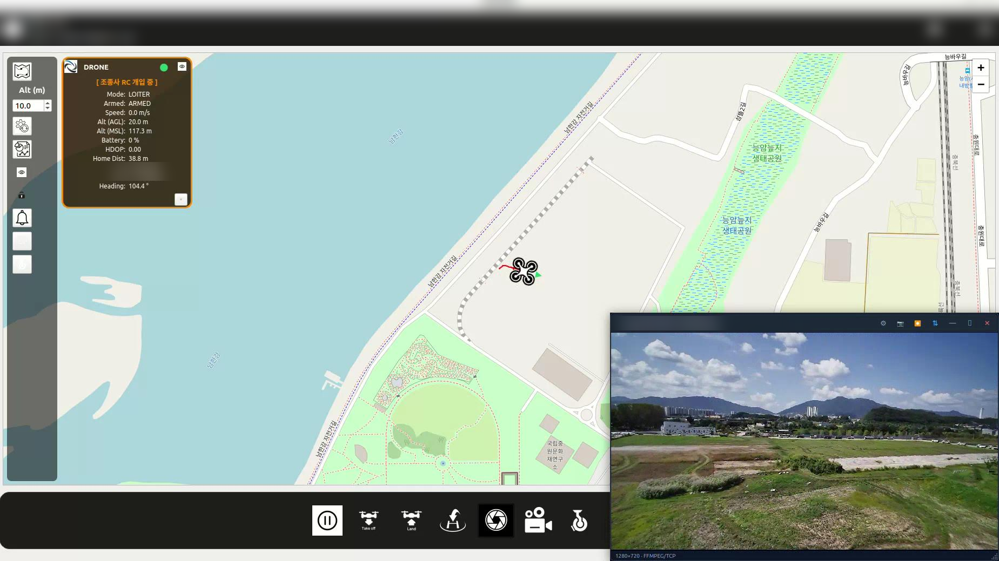
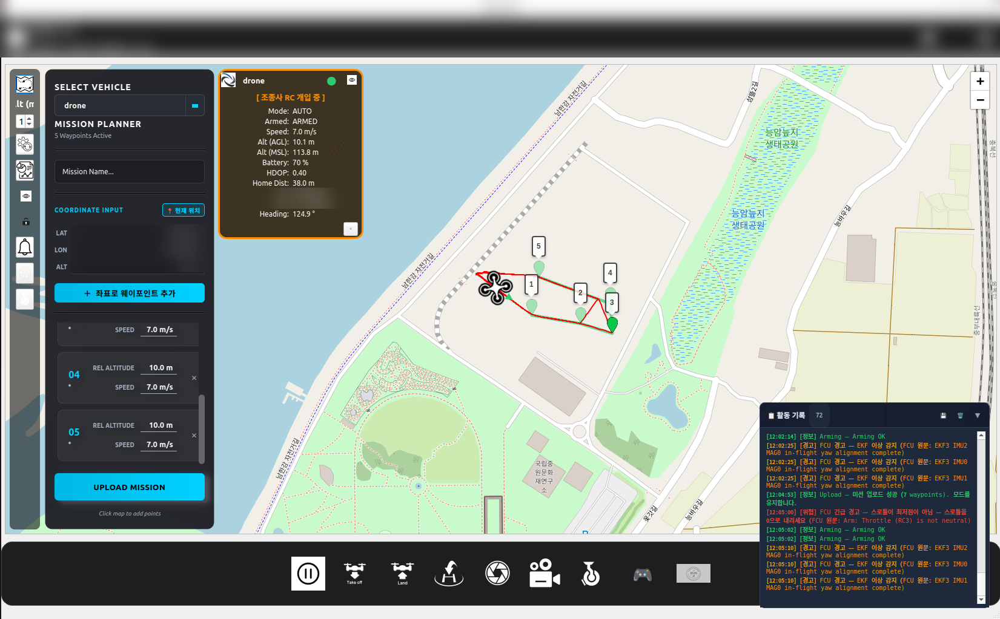
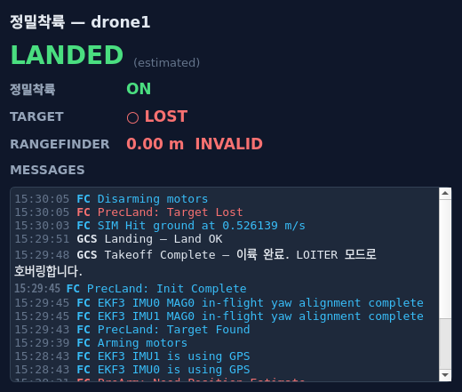

# 03 배송드론 지상관제(GCS) 통합 운용 · 기능 개발

> ROS 2 Humble · MAVROS · FastDDS · Tailscale · ArduPilot · PyQt5 · Jetson · LTE
> 기간 2026.09 ~ · 회사 제품 코드라 **코드는 공개하지 않고** 화면과 결과만 정리했습니다. (화면의 좌표·주소는 가림)

배송드론 1대를 GCS 2대(MAIN·SUB)가 원격으로 운용하는 관제 시스템입니다.

## 1. 통신 이중화 실측 (데이터링크 ↔ LTE)

| 상황 | 사용 경로 | 결과 |
|---|---|---|
| 정상 | 데이터링크 | 지연이 낮은 경로 자동 선택 |
| 데이터링크 단절 | LTE | 4~6 s 끊김 후 복구 · 평균 105 ms, 최대 300 ms |
| 데이터링크 복구 | 데이터링크 | 30~60 s 뒤 무손실 복귀 |
| LTE 단절 | 데이터링크 | 영향 없음 |

- 영상 경로를 10초씩 측정해 선택: 카메라 직결 0.50배속(깨짐) vs 탑재 컴퓨터 재송출 1.03배속 → 재송출을 기본 소스로

## 2. 현장 결함 해결

| 증상 | 원인 | 조치 |
|---|---|---|
| 조종기 명령이 오류 없이 무시됨 | FC의 GCS ID와 MAVROS ID 불일치 | ID 일치 |
| 탑재 컴퓨터 ↔ FC 링크 끊김 | UART 보율 불일치 (오류 카운터로 확인) | 115200 통일 |
| GCS에 GPS 미표시 | 상태 스트림 미송신 | 스트림 요청 설정 |
| 데이터링크 단절 시 명령 차단 | 기체 등록 주소가 내부망 주소 | VPN 주소로 등록 |
| 비행 중 탑재 컴퓨터 멈춤 | 로그 대조 결과 영상 발행 호출이 막힘 | 처리 프로세스 분리안 정리 |

## 3. 기능 개발 (SITL·벤치 검증)

- **미션**: 이륙·착륙·복귀 항목, QGC(.plan)·Mission Planner(.waypoints) 형식 저장·불러오기
- **지도 편집**: 중간점 끼워 넣기, 드래그 중 거리·방위 표시, 되돌리기, FC 미반영 경고
- **FC 파라미터 창**: 검색·수정·확인 후 쓰기, 실패 이유 표시 (실제 FC에서 쓰기·재부팅 후 유지 확인)
- **정밀착륙(IR-LOCK) 패널**: 상태 표시, 거리센서 스트림 자동 요청 → SITL에서 표적 0.22 m 착지

- **저사양 기기 탑재**: ARM 보드(ODROID-C5)에서 대기 CPU **약 207 % → 41 %** (DB 스레드 공회전 수정 + Qt OpenGL 비활성화)

## 4. 시험 자동화

실제 GCS를 **화면 없이(offscreen) SITL과 함께 띄우는 회귀 시험 도구**를 만들어, 기능을 고칠 때마다 수십 개 항목을 반복 검증했습니다. 결과는 비행 로그(BIN) 원본과 대조했습니다.

| 버그 | 원인 | 결과 |
|---|---|---|
| 비행 중 미션 재업로드 실패 | FC가 실행 중 미션 삭제를 거부 (펌웨어 소스 확인) | 삭제 없이 전체 교체 |
| 미션 시작이 LOITER로 덮어써짐 | 이륙 감시와 명령의 경쟁 | 미션 중 LOITER 0회 |
| 링크 단절 오경보 | 현장 기록 172건 중 80 %가 ping 1~2회 실패 | 3회 연속 판정으로 변경 |
| 파라미터 91개 변경 오표시 | float32 표시값 비교 | 비교 방식 수정 |
