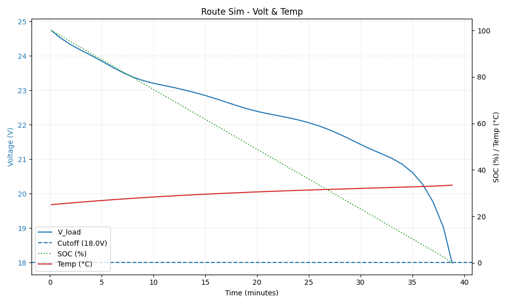

# 드론 배터리 비행 시간·거리 예측 시뮬레이터

> Python · PyQt5 · NumPy · Matplotlib

기체와 배터리 조합을 고르면 **호버 시간 · 최대 비행 거리 · 미션(QGC `.plan`) 완주 가능 여부**를 계산한다.

- **배터리 모델**: OCV 곡선 + 등가회로(내부저항) 기반 정전력 방전, 온도에 따른 저항 변화
- **열 모델**: 발열·냉각으로 배터리 온도를 매 스텝 갱신
- **기체 모델**: 추력·전류 표 보간, 공기 밀도(고도·기온) 보정, VTOL 천이 구간 포함
- **출력**: HTML 리포트와 전압·SoC·온도 그래프



---


멀티콥터·VTOL 기체와 배터리 조합으로 **호버 시간 · 최대 비행 거리 · QGC 미션 비행 가능 여부**를 계산하는 PyQt5 GUI 프로그램.
ROS 와 무관한 단독 파이썬 프로그램이다(그래서 `src/` 없이 평평한 구조를 유지한다).

## 실행

```bash
cd 04_battery-simulator
python3 -m venv venv                      # 처음 한 번 (Python 3.10)
venv/bin/pip install -r requirements.txt  # 처음 한 번
source venv/bin/activate
python battery_sim_gui_unified_main.py
```

- `.ui` 파일은 **실행한 폴더 기준**으로 찾으므로 반드시 이 폴더에서 실행한다.
- 사용자가 추가한 기체·배터리는 `airframes/`·`batteries/` 에 json 으로, 그래프는 `route_plots/` 에 png 로 저장된다.

## 파일 구성

| 구분 | 파일 | 역할 |
|---|---|---|
| 화면 | `battery_sim_gui_unified_main.py` · `battery_sim_gui_unified.ui` | 메인 창 |
| | `battery_sim_controller.py` | 입력 수집 → 시뮬레이션 → 리포트·그래프 |
| | `airframe_add_dialog.py` · `vtol_add_dialog.py` · `battery_add_dialog.py` | 기체·VTOL·배터리 추가 창 |
| 모델 | `core_base.py` | 상수·공기 밀도 |
| | `core_airframe.py` · `core_airframe_registry.py` | 기체 추력·전류 표, 사용자 기체 저장 |
| | `core_battery_params.py` · `core_battery_ocv.py` · `core_battery_resistance.py` · `core_battery_registry.py` | 배터리 사양·OCV 곡선·내부저항, 사용자 배터리 저장 |
| | `core_physics_engine.py` | 추력·전력·발열 1 스텝 계산 |
| 시뮬 | `hover_unified.py` · `route_max_range.py` · `route_mission.py` | 호버 · 최대 거리 · QGC 미션 |
| | `core_path_loader.py` | QGC `.plan` 미션 읽기 |
| 출력 | `report_generator.py` · `plot_generator.py` | HTML 리포트 · 그래프 |

## 정적 검사

```bash
ruff check .   # 기준 = ruff.toml (F·E4·E7·E9)
```

## 코드 정리 과정

원본 → 정적 검사(ruff) 정리 → 한 줄 주석 순서로 나눠 정리했다. 두 정리 단계 모두 동작이 바뀌지 않았음을
기본 기체 3종 × 배터리 5종 조합의 호버·최대 거리 결과가 원본과 바이트 단위로 같은 것으로 확인했다.
