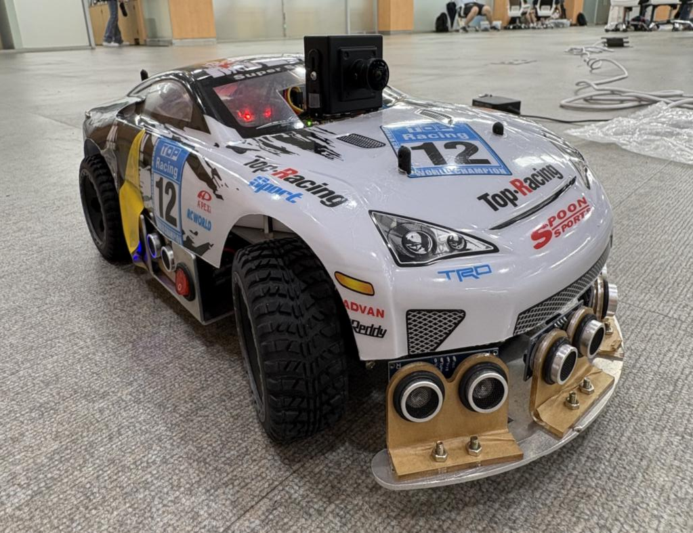
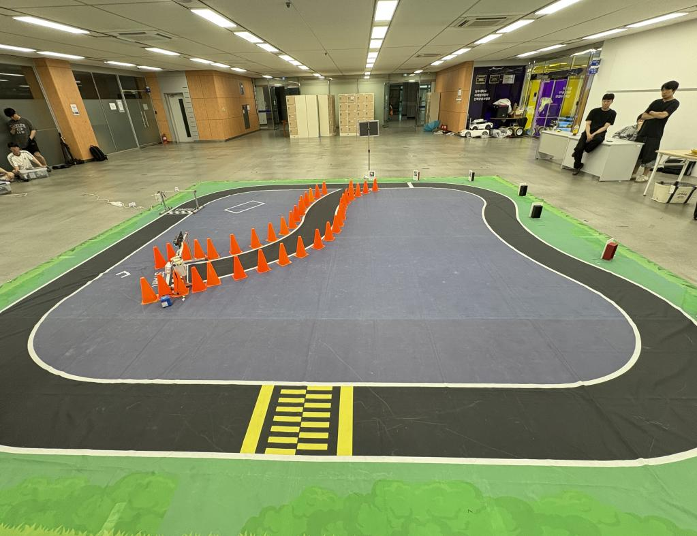
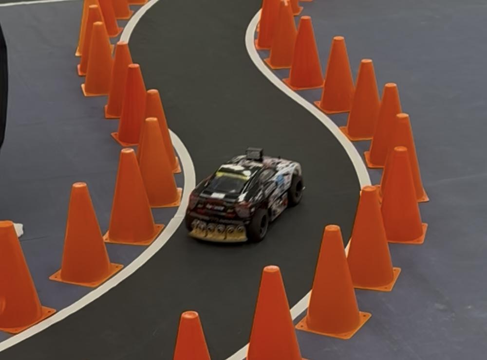

# 05 제6회 자율주행 경진대회 — 장려상

> Ubuntu · ROS · Python · OpenCV · 2025.03 ~ 06
> 미래형자동차 인력양성사업단 주최 · 자이카(Xycar) 차량 플랫폼

## 미션

차량 출발 → 정지선 정차 → 신호등 인식 후 출발 → 장애물 회피 → AR 태그 주행 → 차선 인식 주행 → 고속 주행 → 결승선 통과

## 구현

- **ROS 노드**: Ubuntu에서 ROS 노드로 주행 시스템 실행
- **초음파 센서**: 장애물 거리 파악, 튀는 값 보완 후 조향각 조정
- **카메라 영상 처리 (OpenCV)**: 정지선·신호등 인식, AR 태그의 X 변위로 조향
- **PID 제어**: 조향각 제어, 고속 주행 구간

## 결과

외부 개입 없이 전 구간 자율 완주, **장려상** 수상

| 트랙 | 장애물 회피 |
|---|---|
|  |  |
