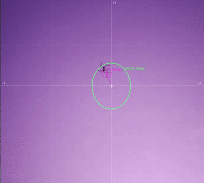
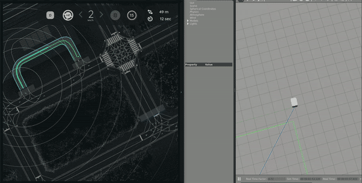
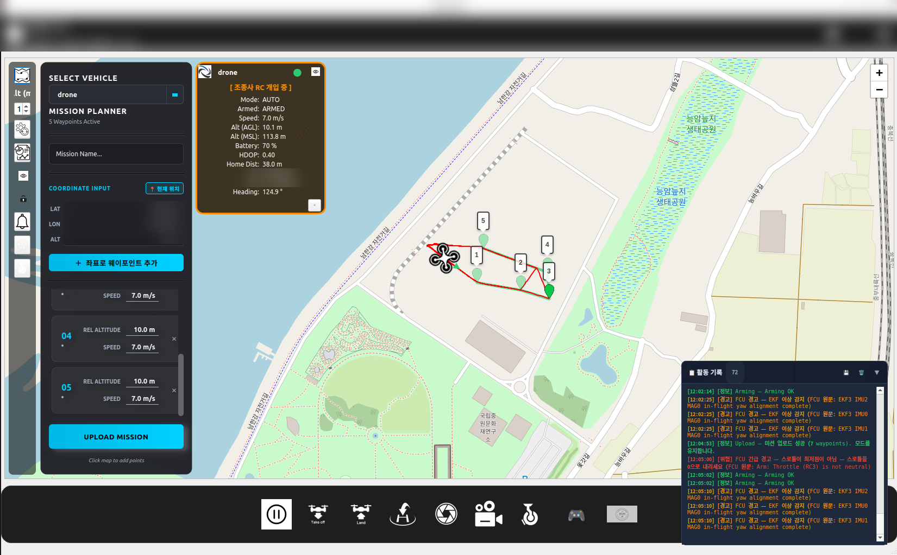
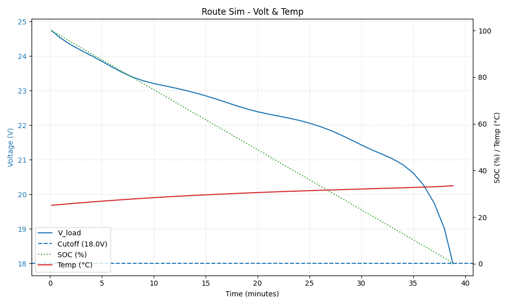
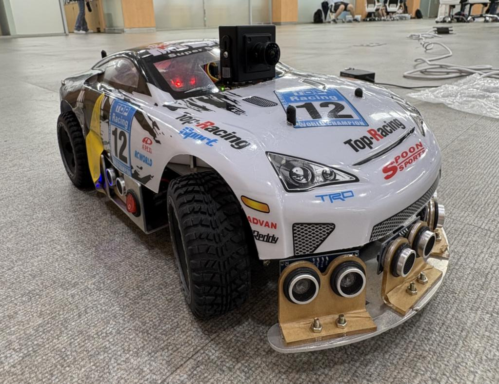

# 박세진 · Portfolio

ROS 2 기반 드론·자율주행 소프트웨어를 만들고, **실기체와 시뮬레이션에서 측정한 데이터로 검증**하는 일을 해 왔습니다.

- **환경**: Ubuntu 22.04 · ROS 2 Humble · Python · C++ · OpenCV · Git
- **비행 제어**: ArduPilot · MAVROS / MAVLink · Gazebo SITL
- **자율주행**: Autoware (라이다 인지·차량 인터페이스·Lanelet2 지도)
- **기타**: PyQt5 GUI · rosbag 계측과 판정 스크립트 · Jetson · Raspberry Pi

## 프로젝트

| | 프로젝트 | 내용 | 공개 범위 |
|---|---|---|---|
|  | [**01 카메라 기반 드론 표적 추적**](01_visual-servoing/) | 단안 카메라 영상 기반(IBVS) 폐루프 추적 제어기 설계, 실기 비행 검증 | 설명·결과·영상 |
|  | [**02 Autoware 3D 라이다 인지 · UGV 연동**](02_autoware-lidar/) | 라이다 인지 파이프라인 구성과 실시간 검증, 차량·센서 구성, Gazebo 연동 | 직접 만든 도구 코드 |
|  | [**03 배송드론 지상관제(GCS)**](03_gcs/) | 통신 이중화 실측, 제어권 이양, 미션·파라미터·정밀착륙 기능, 시험 자동화 | 설명·화면 |
|  | [**04 배터리 비행 시간·거리 시뮬레이터**](04_battery-simulator/) | OCV·등가회로·열 모델 기반 호버·최대 거리·미션 예측 GUI | 전체 코드 |
|  | [**05 자율주행 경진대회 (장려상)**](05_xycar/) | 정지선·신호등·장애물 회피·AR 태그·차선 주행 | 설명·사진 |

> 01·03은 회사 업무로 개발한 것이라 코드는 공개하지 않고 설계와 결과만 정리했습니다.
